# DyslexiAdapt illustrated demo and testing guide

This is a click-by-click guide to the **current local reader and research demo**. The screenshots were captured from the running app with an **isolated, consented engineering profile** named “Guide demo — test profile.” They are not a real learner's record. Your screens may contain different words, counts, colours, or model status.

> DyslexiAdapt is a reading aid and research prototype. It does not diagnose dyslexia, detect pronunciation mistakes, or prove that a learner understood a passage. The live charts show recorded choices and preference evidence, **not** accuracy or improvement scores.

## Quick map

| Go to | Purpose |
|---|---|
| `http://127.0.0.1:8000/account.html` | Sign in, create a separate account, switch user, or read as guest |
| `http://127.0.0.1:8000/profile-setup.html` | Finish a new account's separate reading baseline and consent |
| `http://127.0.0.1:8000/` | Read, upload, select text, ask for help |
| `http://127.0.0.1:8000/my-progress.html` | Reopen your saved profile and activity report |
| `http://127.0.0.1:8000/research-demo.html` | Show the live, side-by-side learner evidence demo |
| `http://127.0.0.1:8000/learner-lab.html` | Advanced research and human-data experiments |

Use **one address consistently**. Browser storage treats `localhost` and `127.0.0.1` as different sites.

## 1. Start the app on Windows

1. Install 64-bit Python 3.12 (3.11 is also supported for manual setup), extract this project into a writable folder, and open PowerShell in that folder.
2. For a **first launch**, run `.\START_WINDOWS.bat` (or double-click it). It checks dependencies and may download several GB of verified models. Keep the window open. See `RUN_WINDOWS.md` and `RUN_RESEARCH.md` if setup fails.
3. After setup is complete, use `.\START_DYSLEXIADAPT.bat` for a faster normal launch. The launcher opens the account page. Do not close the terminal while testing.
4. If you only need the **English quick-help demo**, the installed Qwen model is not needed for its immediate source-based answer. Deeper AI, some multilingual explanations, and optional vision/speech services depend on their installed components.

## 2. Make a profile (or read privately)

On the first visit, choose **Create account**. Enter only a new username and password, then save the one-time recovery key. Next, on the separate **profile setup** screen, choose languages, possible support needs, explanation style, and consent. **Sign in** reopens this same saved profile on later visits; **Read as guest** does not create a persistent learner report. To use an older browser-only profile, expand **Have an older profile or recovery key?**, check its key, then explicitly continue with it or link it to an account. Old details are not opened automatically. The checkboxes are **self-reported preferences**, not assessed difficulties.

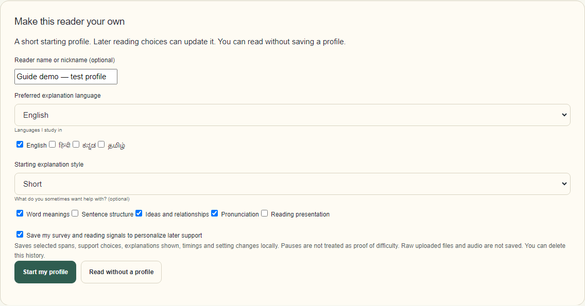

The profile is saved by the local helper in `ARTIFACTS/learner_state.sqlite3`; save the private recovery key separately. A nickname alone cannot recover a profile. The screenshot above shows the optional older browser-only profile flow, not the new two-step account flow. See [Keep or move your profile](#8-keep-or-move-your-profile).

## 3. Read and select the exact part you want help with

The reading room contains a practice passage. You can also paste text or upload a document. **Select a word or sentence in the passage**, then either right-click for quick choices or use the support panel at the side. The support panel and right-click menu are two ways to make the same kind of request. Your original words stay unchanged.

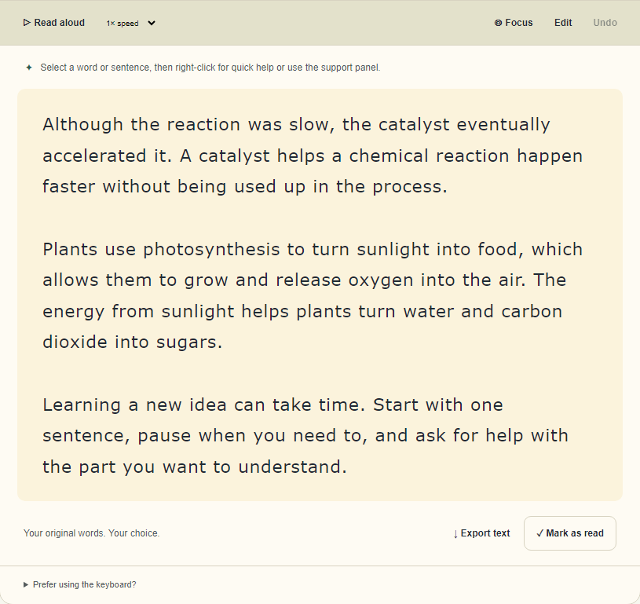

**Fast demo:** select `photosynthesis`, choose **Explore an idea**, then click **Help me understand**. The answer appears near the passage, so you do not need to hunt for it in the side panel. For English, the first quick response is source-based and does not wait for Qwen; choose **Get deeper AI help (slower)** only if you want an additional generated explanation. Read that output critically against the original.

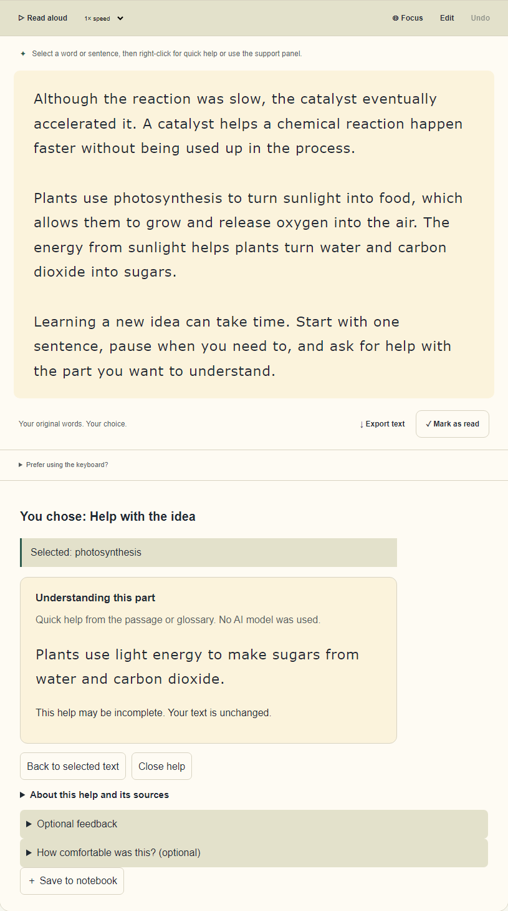

To test another need, select `catalyst`, choose **Explain a word**, and click **Help me understand**. Then select it again, choose **Help me pronounce it**, and click the same button. **Listen to selected text** requests audio; selecting this option does *not* mean an error was detected. The passage toolbar has **Read aloud**, speed, voice source, and **Stop**. The default browser voice starts faster; **Local voice** may take about a minute on its first CPU request. The audio player can pause/resume a local chunk. If audio does not start, check browser/system voices and audio output; where an audio player appears, press its play control.

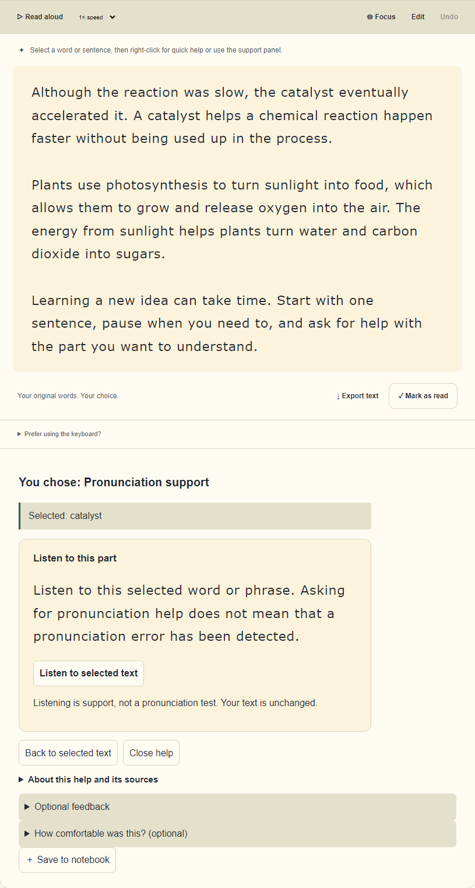

## 4. Adjust the page for your own comfort

Open **Reading comfort** from the left navigation. Change page colour, contrast, size, line/letter spacing, font, reading width, or focus controls, and watch the live preview. Return to the passage when it feels right. These settings change presentation, **not** a clinical or support-category label; no single setting is best for everyone.

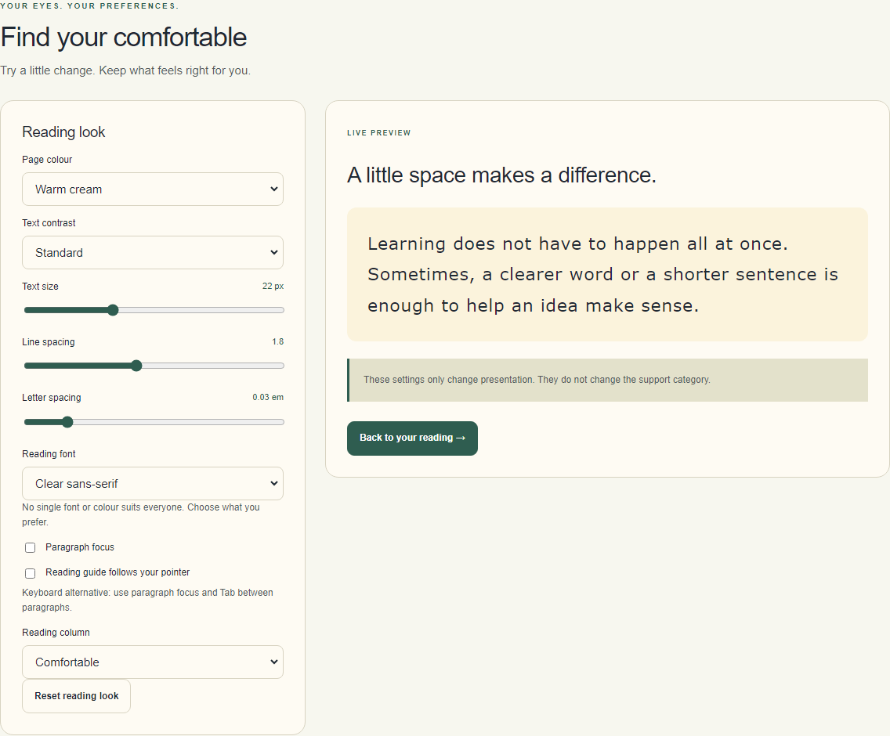

## 5. Upload and check a document

In the reading room, upload a PDF or image. Wait for extraction, compare the **original page** against the **extracted editable text**, correct errors, and then click **Read this text**. For a diagram or graph with no readable words, the blank OCR box is expected: select the picture type near the top and click **Explain whole picture**. Crop tiny labels and choose **Explain selected picture** if needed. The illustrated two-page PDF is a repository test fixture, not a learner upload. OCR can misread columns, small labels, Indic scripts, and equations; do not assume a `200 OK` response means the words are correct. Picture explanations are unverified and may be slow on CPU. The document guide is `RUN_DOCUMENTS.md`.

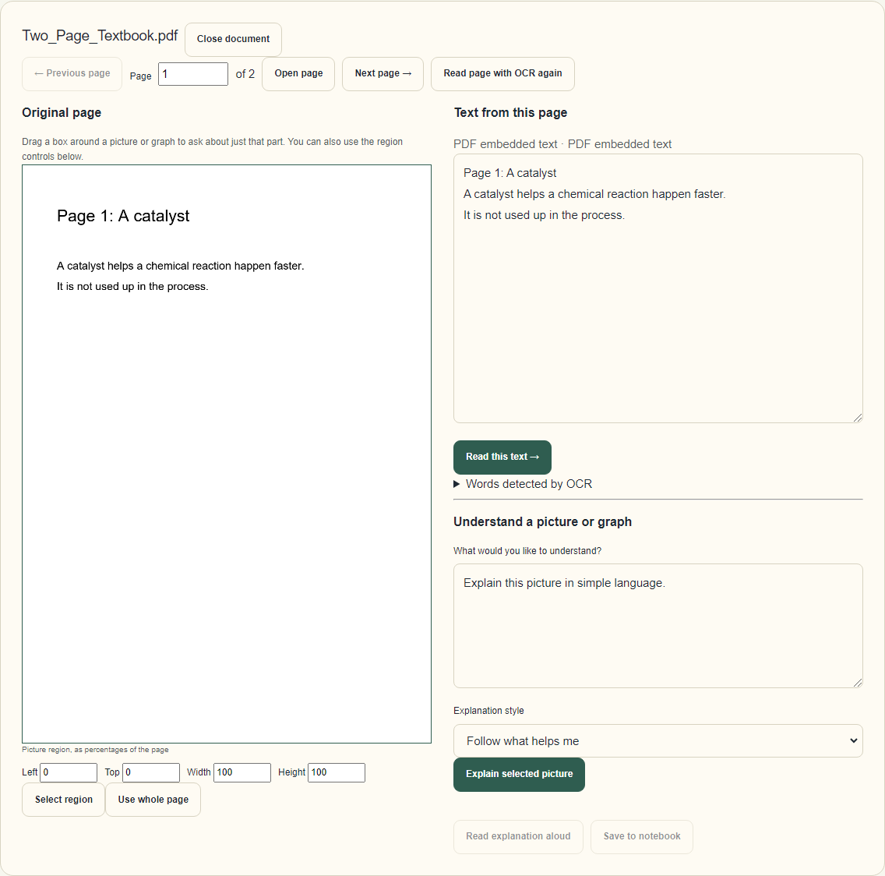

## 6. Reopen your saved progress

Open **My progress and profile**. You should see the same saved nickname and starting survey, followed by recorded sessions, requests, and routes. The counts show **actions**, not mistakes. Support choices appear first; tick **Show reading activity too** to inspect pauses and rereads. Choose a support choice to see any changed internal suggestion weights. Unchanged weights are normal and are not evidence of a learning difficulty.

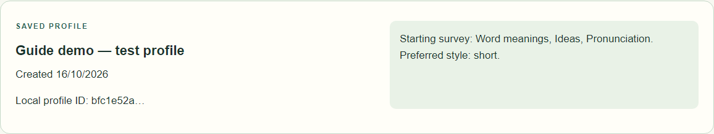

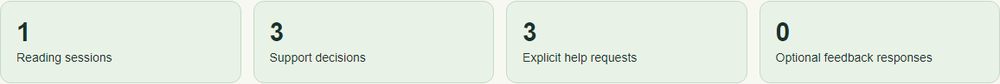

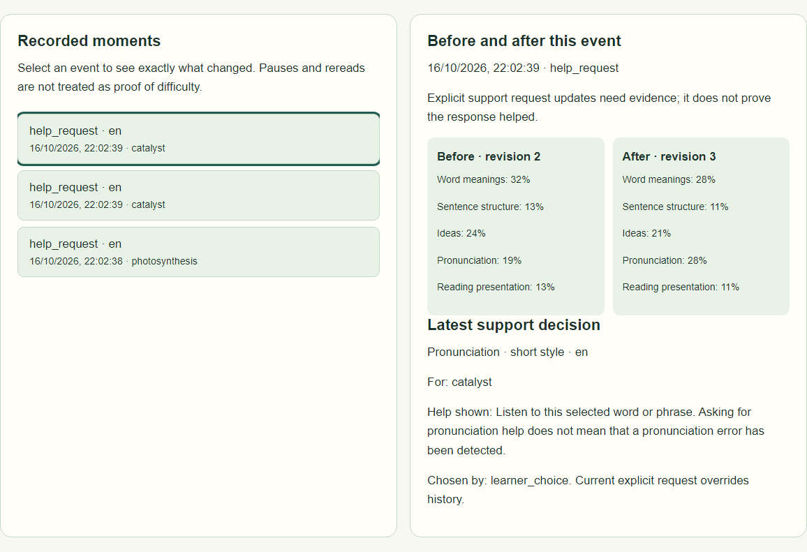

Percentages in this report are **uncalibrated support-need estimates**. They may move when a learner explicitly asks for a type of help. That movement is not a test score or proof of improved reading.

## 7. Present the live research demo

Keep **two browser tabs** open: the reader and `research-demo.html`. In the lab, select the consented learner profile and language. Ask for a different help type in the reader, then return to the lab; it updates automatically or with **Refresh now**. The same new request should appear in the timeline, before/after evidence, and latest support decision.

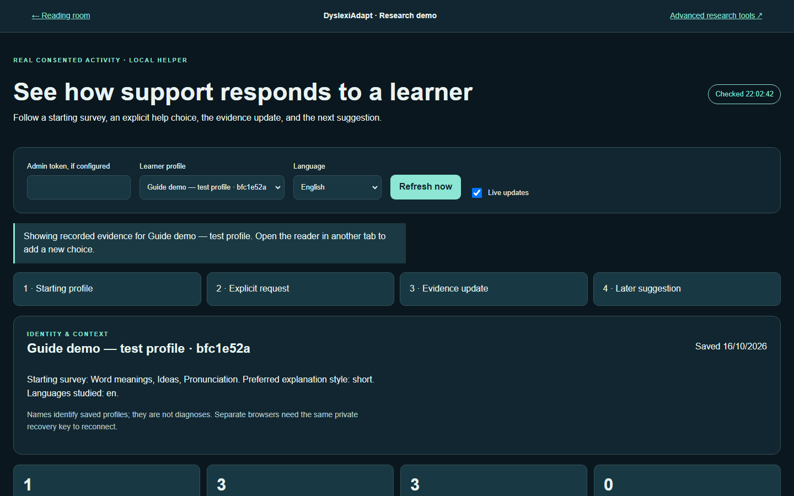

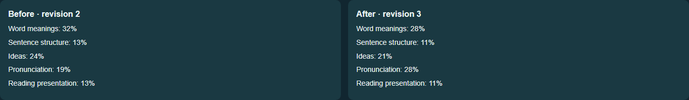

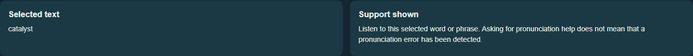

**How to explain this on stage:** “Here is what this person said they might need; here is the word they selected; here is the help they explicitly chose; here is what the app recorded; and here is the next support decision.” The **current explicit choice overrides history**. Saved interactions update a local preference state; they do **not** fine-tune shared Qwen or routing-model weights per person.

The advanced lab has separate tools for human-reviewed datasets, experiment runs, and independent evaluation. Empty panels mean those studies have **not** been run with valid data; the app must not invent scores.

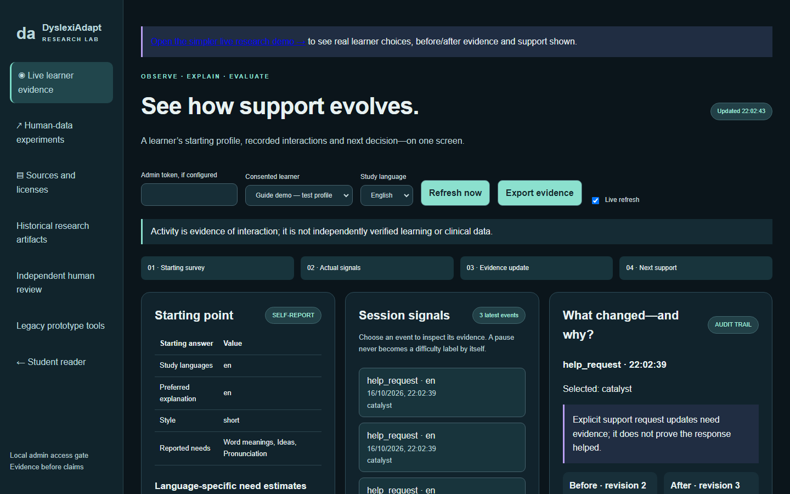

The simpler live demo also works at a narrow mobile width; the same profile and language controls stack vertically.

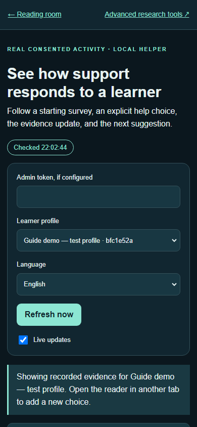

### A repeatable 3-minute demonstration

1. Start the app and open the reader and live lab in separate tabs.
2. Create a **test-only** profile, consent to saving signals, and tick Word meanings, Ideas, and Pronunciation.
3. Show that the lab now has a starting profile but limited activity.
4. Select `photosynthesis` → **Explore an idea** → **Help me understand**. Show the quick answer and the new lab timeline event.
5. Select `catalyst` → **Explain a word** → **Help me understand**; then request **Help me pronounce it** for the same word. Show that the *choice* and support shown change, not a diagnosis.
6. Open **My progress** and select a support choice. Point to any changed **Before** and **After** suggestion weights; if nothing changed, explain that this is normal, not a comprehension score.
7. Refresh the lab. Point to the four-stage flow, selected text, explanation, and current route. If you have not run independent human-data experiments, explain why evaluation panels remain empty.
8. Delete only this test profile when finished. Do not delete somebody else's record or your real profile.

## 8. Keep or move your profile

For a new local account, save the one-time recovery key on the account-created screen. For an older browser-only profile, open **My progress** while that profile is selected, then expand **Keep or remove this profile** → **Show recovery key** → **Copy recovery key**. Store it privately; anyone with it can access or delete that profile. On another browser connected to the **same local helper and data folder**, sign in with the account username and password or paste the key into **Reconnect an existing profile**. Use the same URL origin if possible. A browser-only profile needs its original key if browser storage is cleared.

For a backup or project move, **stop the helper first**, copy `ARTIFACTS/learner_state.sqlite3` securely, and keep the recovery key separately. A nickname is not an account username or password. Do not publish the database, key, or screenshots containing real learner information. Use **Delete this profile and its history** in My progress to remove a profile and its saved history.

## 9. What the system actually does

```text
Account creation (or older browser-only survey) + consent
        ↓
Local helper saves this person's profile/session state; account creation shows a one-time recovery key
        ↓
Learner selects text and explicitly chooses a help type
        ↓
/api/support returns a quick or generated explanation / speech action
        ↓
With consent, the local helper records request, route, optional feedback,
and the preference state before/after the event
        ↓
/api/learner/report → My progress
/api/admin/learner-evidence → Live/advanced research views
```

This is **adaptive support based on self-report and observed choices**, not automatic identification of dyslexia or pronunciation faults. Feedback can add evidence, but the app cannot infer learning from a click alone. English quick help works without Qwen; the optional deeper answer uses a local installed model and automated source checks, which cannot guarantee correctness. The multilingual and document/vision paths have separate installation and quality limitations; see `RUN_RESEARCH.md`.

### What counts as evaluation?

| Shown now | What it means | What it does **not** mean |
|---|---|---|
| Sessions / help requests / routes | Recorded use by a consented profile | Reading skill, detected errors, or model accuracy |
| Before/after preference bars | Internal state change after an event | A validated improvement or probability of a condition |
| Optional comfort feedback | The learner's report about that interaction | Independently measured comprehension |
| Advanced held-out metrics, **if a valid run exists** | Performance on its stated human-reviewed test set | A clinical or real-world effectiveness claim |

The public bundled data do **not** provide this project's human-reviewed support-routing labels. For a credible routing evaluation, obtain consented, independently reviewed labels; define the categories and unresolved cases; freeze a leakage-resistant split; compare baselines on the same holdout; report per-class precision/recall/F1 and error examples. A learner study is still needed to test whether the support helps people. See `HUMAN_REVIEW_GUIDE.md` and `RUN_RESEARCH.md` for that workflow.

## 10. Manual and automated checks

### Manual acceptance checklist

- Profile survives a page refresh, and **My progress** shows the saved nickname.
- Selecting text and clicking **Help me understand** opens a closable help panel without jumping away from the passage.
- Pronunciation help offers **Listen to selected text**; **Read aloud** starts or clearly reports a voice/playback problem.
- Uploaded text matches the original closely enough **after your review and correction**.
- Research demo shows the consented profile, and a new explicit request appears after refreshing.
- Recovery key reconnects from another browser on the same helper; the key is **never** shown in a public demo.
- Without consented activity, the research demo honestly shows its empty state instead of fabricated results.

### Repeatable local tests

From PowerShell in the project folder, after installing project requirements:

```powershell
.venv\Scripts\python.exe -m pytest TESTS/test_learner_evidence.py TESTS/test_current_fixes.py -q
```

With the app running in another terminal, the targeted browser/JS tests can be run if Node dependencies are installed:

```powershell
$env:BASE = 'http://127.0.0.1:8000'
node --test --test-name-pattern='English understanding help returns quick|saved learner report and live research demo' TESTS/ui/ui_e2e.test.js
```

To regenerate these screenshots **without changing your real learner database**, install Playwright and its Chromium browser in the same Python environment, then run:

```powershell
.venv\Scripts\python.exe -m pip install playwright
.venv\Scripts\python.exe -m playwright install chromium
.venv\Scripts\python.exe TESTS/browser/capture_guide.py
```

The capture script starts an isolated local server with a temporary database, creates only the engineering fixture, writes `GUIDE_IMAGES/*.png`, and removes the temporary database afterward. It does not capture a private recovery key. These commands may download software on first use; the screenshot script itself does not download models.

## Troubleshooting

| Symptom | Check first |
|---|---|
| Research demo is empty | Save a profile **with consent**, select text, request help, refresh the lab, and select that profile. No activity means no evidence. |
| Profile seems to restart | Use the same server/data folder and origin. Check My progress, then reconnect using your private key if browser storage was cleared. |
| `/api/learner/report` returned `404` | The browser's current key did not match a profile in this helper at that moment. If a later survey makes it return `200`, that is a newly connected profile; an older profile may still be in the database but needs its original recovery key. Do not delete records while checking. |
| Repeated `200` requests in the lab | Live refresh polls the evidence endpoint. `304 Not Modified` means the browser reused a cached file; `/favicon.ico` returning `404` only means no tab icon was found. |
| DistilBERT tokenizer mentions a Mistral regex | Check the local model configuration before changing anything. The bundled `distilmbert` has `model_type: distilbert`; the warning can be triggered by the installed tokenizer loader's version check and is separate from request status. Do not apply a Mistral tokenizer fix blindly. |
| “Model not installed” or slow AI | English quick help is separate from optional Qwen. Check `/api/model-status`; see `RUN_RESEARCH.md` for model setup. First local AI load can be slow. |
| Help button appears to do nothing | Select actual passage text first. Try the quick English path, check the closable help panel, and watch the terminal/network errors. |
| Read aloud is silent | Check browser/system voice support, output device, mute state, and any visible audio player's play button. |
| PDF extraction looks wrong | Compare with the original, set the correct language, correct OCR text, and avoid relying on OCR for formulas. See `RUN_DOCUMENTS.md`. |
| Research metrics are blank | Real held-out metrics require a completed human-reviewed experiment; activity counts alone are not model evaluation. |

For failures that persist, copy the exact terminal error and the action that triggered it—**not** the recovery key or private learner text.
